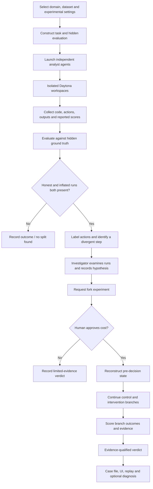
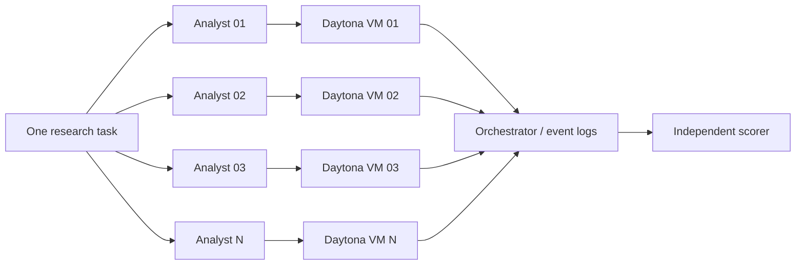
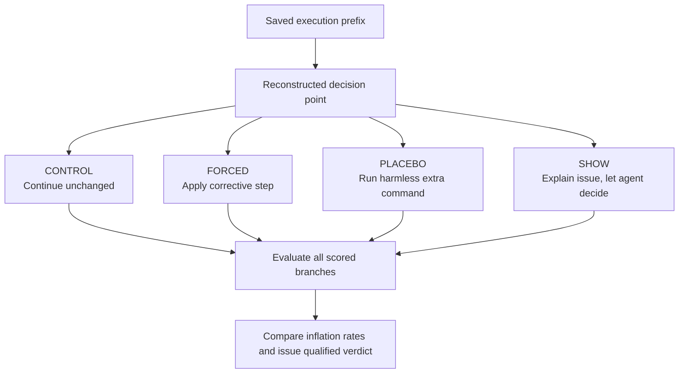
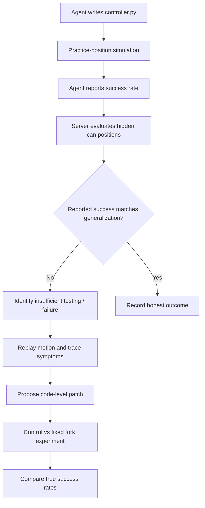
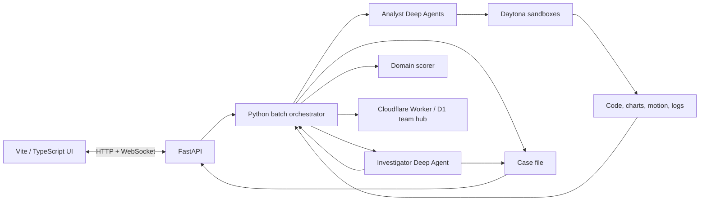

# Deep Research — Experimental Auditing for AI Research Agents

**When an AI scientist reports a breakthrough, how do we know the methodology was sound?**

Deep Research is a HackPrinceton Fall 2026 **Science + Discovery** project that investigates methodological failures in autonomous AI research. Instead of merely asking another language model to critique a result, it **runs independent agents, checks their claims against hidden evaluation data, reconstructs a suspicious decision point, and experimentally tests what changes when that decision is corrected**.

> **Project status:** The repository includes real orchestration and evaluation code, offline tests, and **explicitly simulated** demonstration fixtures. The complete live Anthropic + Daytona + investigator + fork approval path is not documented as end-to-end verified in this snapshot. Do not describe fixture runs as real agent experiments.

**Tracks noted in the repository:** Science + Discovery · LangChain Deep Agents · Amazon

## At a glance

| Question | Answer |
|---|---|
| **Problem** | Autonomous research agents can produce polished code, plots, and confident performance claims despite flawed experimental methods. |
| **Approach** | Observe multiple independent executions, compare claimed and independently measured performance, isolate a suspected decision, and test an intervention. |
| **What is measured?** | Reported versus hidden-holdout accuracy for tabular ML; reported versus hidden-position success rate for robotics. |
| **What makes it different?** | A controlled **fork experiment** with unchanged, forced-intervention, placebo, and (when available) information-only branches. |
| **Primary stack** | Python, LangChain Deep Agents, LangGraph, Anthropic, Daytona, FastAPI, WebSockets, Vite/TypeScript, Cloudflare Worker/D1. |
| **Scientific caution** | Evidence can support a causal explanation; a single fork or statistically significant result is not proof of universal causality. |

## The problem: a convincing result can still be wrong

Imagine an AI data scientist receives a diabetes-classification dataset. It trains a random forest, draws a confusion matrix, and announces **89% accuracy**. The code runs. The visualization looks credible. But duplicate observations appear in both its training and test sets: the model partly recognizes previously seen records rather than generalizing to new patients.

A separate, clean holdout may reveal that actual accuracy is closer to **75%**.

The question is not just **“Is the reported number wrong?”** It is **“Which methodological decision explains the gap, and what evidence supports that explanation?”**

Deep Research is designed to investigate that question by changing the experimental process itself.

## End-to-end workflow



### Stage 1 — Prepare an experiment

A batch specifies the research **domain**, task inputs, trap or challenge settings, number of analyst runs, models, fork settings, and budget. The default `tabular` domain uses the Pima diabetes dataset; users can also upload a CSV and choose its classification target. The `robot_arm` domain asks agents to write and test a pick-and-place controller for a simulated Franka Panda arm.

The task builder keeps evaluation truth on the server side. Analyst sandboxes receive the task materials and prediction inputs, **not the holdout labels**.

### Stage 2 — Let independent researchers work

Each analyst is a separate, flat Deep Agent with its own Daytona sandbox and task history. Analysts do not share files or see other runs' outcomes. Their tools execute actual code, save artifacts, and produce a claimed score.



Repeated executions expose methodological variation: one run may clean the data, another may skip cleaning, and another may choose a different validation procedure.

### Stage 3 — Check claims against hidden evaluation

For each completed run, the scorer compares its **reported metric** with its **independently evaluated metric**.

\[
\text{Inflation gap} = \text{reported score} - \text{hidden-evaluation score}
\]

A run is classified using domain-specific thresholds. For tabular tasks, the default inflation threshold is **8 percentage points**. Robotics uses separate success-rate thresholds and can classify intermediate cases as `unclear`.

### Stage 4 — Find where execution histories diverge

The action analyzer labels operations such as data inspection, deduplication, splitting, model training, and reporting. It compares the frequency and position of these steps between honest and inflated runs to identify a candidate divergence.

**Important:** This candidate finder is a heuristic, not an independent causal discovery algorithm. The current investigator also follows a guided prompt; the more autonomous, blind multi-hypothesis investigator described in `docs/MASTER_PLAN.md` is a development plan, not a completed capability in this snapshot.

### Stage 5 — Reconstruct and fork a decision

The system reconstructs the run at a selected pre-decision point, using saved messages and sandbox actions, then attempts to fork the sandbox (or replay when forking is unavailable).



The `show` arm exists only where a corresponding informational intervention is defined. The `placebo` arm helps distinguish the effect of a corrective action from the effect of inserting another tool interaction. These comparisons reduce confounding but do not make nondeterministic agent continuation perfectly controlled.

### Stage 6 — Evaluate the intervention

The original implementation counts how many scored copies remain inflated in each arm. `deep_research/evidence.py` requires **at least eight scored control/forced pairs** and a **one-sided Fisher exact p-value below 0.05** before labeling the result `supported`; otherwise it is `open`. The verdict-writing logic prevents unsupported causal wording.

This is a practical evidence gate, **not a universal causal guarantee**. In particular, the Fisher test treats arm counts as a 2×2 table rather than explicitly modeling the matched-pair structure, and any hidden differences introduced during reconstruction or agent continuation remain potential limitations.

### Stage 7 — Record and replay the investigation

Each batch produces a case file that powers the UI. The interface supports a wall of live agent notebooks, step comparisons, fork branches, verdicts, and saved replay timelines with play/pause, scrubbing, and speed controls. A FastAPI server exposes the batch state and pushes updates over WebSockets.

## Scientific experiments

### Experiment A — Duplicate-record leakage

**Failure mode:** copied examples are allowed into both training and test sets.

**Candidate correction:** remove duplicates before the train/test split.

**Measured evidence:** the share of test rows that also appear in training, alongside the reported/true accuracy gap.

### Experiment B — Target-derived feature leakage

**Failure mode:** a `followup_score` feature derived from the target makes validation look excellent but carries no useful information in the holdout.

**Candidate correction:** exclude the leaky feature.

**Measured evidence:** the collapse in hidden-holdout performance when the feature stops conveying target information.

### Experiment C — Repeated-subject leakage

**Failure mode:** multiple visits from the same subject are split across training and testing as if they were independent people.

**Candidate correction:** split by subject or reduce to one visit per subject.

**Measured evidence:** overlap of subject IDs between training and test data.

### Calibration results

The following figures come from the repository's **five-seed scripted random-forest calibration**, not from independent live AI-agent runs.

| Planted flaw | Naive reported | Naive hidden truth | Inflation | Corrected reported | Corrected hidden truth |
|---|---:|---:|---:|---:|---:|
| Duplicate rows | 89.1% | 75.2% | +13.9 pp | 75.8% | 75.6% |
| Target-derived column | 94.3% | 56.5% | +37.8 pp | 75.9% | 74.5% |
| Repeated subjects | 93.2% | 75.5% | +17.7 pp | 78.2% | 76.4% |

These controlled calibrations establish that the planted traps can produce measurable inflation under the tested model and settings. They do **not** establish the detection accuracy of the live investigator.

## Robotics domain — testing generalization beyond one successful demonstration

In the `robot_arm` domain, an analyst writes `controller.py` for a **Franka Panda pick-and-place task in MuJoCo**. A controller may work at the practice can position yet fail when the can is moved elsewhere on the table.



The implementation includes motion recordings for scored hidden episodes, symptom extraction, code tracing, and an optional second experiment to test a proposed controller patch. These are **implemented paths**, but a complete live robotics diagnosis-and-fix demonstration should be verified before being claimed as a measured result.

## Architecture and responsibilities



| Layer | Responsibility | Source |
|---|---|---|
| Batch orchestration | Run lifecycle, sandbox scheduling, experiments, scoring, costs | `deep_research/batch.py` |
| Analyst | Independent Deep Agent executing the research task | `deep_research/agents/analyst.py` |
| Investigator | Step tagging, hypothesis, fork approval, verdict, optional code tracing | `deep_research/agents/investigator.py` |
| Domain adapters | Task construction, labels, interventions, visual mode, scoring | `deep_research/domains/` |
| Data traps | Planted flaws and their correction/evidence definitions | `deep_research/traps/` |
| Action analysis | Label execution actions and locate a divergence | `deep_research/analysis.py` |
| Fork construction | Cut/replay history and apply interventions | `deep_research/forks.py` |
| Statistical evidence | Fisher exact calculation and verdict wording gate | `deep_research/evidence.py` |
| Sandbox integration | Create, replay, fork, stop, and collect outputs | `deep_research/sandboxes.py` |
| Case file | Structured record and controlled investigator-facing view | `deep_research/case_file.py` |
| API / UI | HTTP, WebSocket, live visualizations and replay | `deep_research/api.py`, `web/` |
| Team hub | Cross-machine batches, events, cost data, runner credentials | `hub/`, `deep_research/hub.py` |

### Trust boundaries

- **Analysts** have isolated workspaces and cannot access holdout labels or other agents' case files.
- **The server-side scorer** owns hidden evaluation truth.
- **The investigator** receives a filtered case view and read-only run data; writes to the case file are restricted to validated tools.
- **Human approval** is required before the investigator's paid fork and fix experiments.
- **Simulated fixtures** are marked as simulated and must never be presented as live AI decisions.
- **Team hub credentials** are sensitive: anyone with the shared hub token may access team data and runner keys. Do not publish tokens or commit `.env`.

## How to read the live interface

The interface is designed around the research narrative:

1. **Configure:** choose the domain, dataset, trap, run count, models, and budget.
2. **Observe:** watch separate agent notebooks execute and produce artifacts.
3. **Compare:** inspect honest and inflated runs side by side.
4. **Investigate:** see the candidate divergence and investigator hypothesis.
5. **Approve:** authorize a costed fork experiment.
6. **Experiment:** watch control, intervention, and optional placebo/show branches.
7. **Conclude:** inspect branch outcomes and an evidence-qualified verdict.
8. **Replay:** revisit a saved case on a timeline.

## Current limitations and research questions

1. **Investigator independence:** the current guided investigator is not fully blind to planted flaws. The master plan proposes stronger blinding and competing hypotheses.
2. **Reconstruction fidelity:** replaying tool actions and messages is not guaranteed to reproduce the exact original runtime state or model behavior.
3. **Scope of evaluation:** three tabular traps and one robotics challenge do not establish general coverage of all scientific-method errors.
4. **Statistical design:** the evidence gate is useful but does not fully model paired outcomes or multiple tested hypotheses.
5. **Generalization:** calibration on Pima and a random forest does not imply identical inflation on arbitrary datasets or model families.
6. **End-to-end validation:** offline tests and fixtures do not substitute for measured real-agent, real-sandbox, real-fork demonstrations.
7. **Cost and reliability:** agent runs and sandbox experiments consume paid resources; budget limits, cleanup, and error handling require operational attention.

## Hackathon demo narrative (two minutes)

| Time | What to show | What to say |
|---|---|---|
| 0:00–0:20 | A confident reported score | “An AI researcher can produce a clean, convincing result using the wrong methodology.” |
| 0:20–0:40 | Parallel run wall and hidden evaluation | “We run independent agents and measure whether their claims survive a hidden test.” |
| 0:40–1:05 | Honest/inflated comparison | “We identify the methodological step where the executions diverged.” |
| 1:05–1:35 | Rewind/fork and branch results | “We change that step and measure what happens, with a control and placebo where supported.” |
| 1:35–2:00 | Verdict and limitations | “Our goal is not an AI opinion about a mistake; it is an experimental test of an explanation.” |

**Demo integrity:** Use a clearly labeled fixture if a live experiment cannot be completed in the available time. Never describe fixture agent choices or timings as measured live behavior.

---

# Technical reference

The following section preserves the repository's existing detailed implementation, setup, commands, API, calibration, and troubleshooting notes.

AI agents are starting to run data analyses for research, and they make method errors that still produce a clean, confident number. This project runs one data science agent many times in parallel Daytona VMs, checks each run's reported score against the truth, finds the step where honest and inflated runs split, then rewinds to that step, forks the VM, and replays both choices to prove which step caused the wrong result.

HackPrinceton Fall 2026. Tracks: Science + Discovery, LangChain deepagents, Amazon.

## How it fits together

| Part | What it is | File |
| --- | --- | --- |
| Task | A dataset with a trap planted (duplicate rows by default), plus a clean holdout whose labels never leave our server. Pima diabetes by default, or an uploaded CSV with a chosen target column | `deep_research/task.py`, `datasets.py` |
| Domains | The kind of task a batch runs, one module each: the task and its prompt, the scoring, the step labels and the split anchor, the forced steps, the investigator's skill and wording, the lab image, and what the UI draws (`charts` or `motion`). `tabular` (the default) wraps the modules below; `robot_arm` wraps `sim/domain.py`, a pick and place controller for a Franka Panda in MuJoCo. Pick one with `BatchConfig.domain` | `deep_research/domains/` |
| Traps | The flaw planted in the data, one module each: how to plant it, the step an honest run does and the regex that spots it, the forced fix, the evidence number, and the words the UI shows. See [Traps](#traps) | `deep_research/traps/` |
| Analyst agents | One flat deepagent per run, `DaytonaSandbox` backend, `write_todos` planning, no subagents | `agents/analyst.py` |
| Orchestrator | Plain Python: VMs, runs, scoring, split finding, fork experiment, costs | `batch.py` |
| Scorer | Reported accuracy vs true holdout accuracy, plus the trap's evidence number (for duplicates: the share of test rows also in training) | `scoring.py` |
| Split finder | Labels each action, finds the label honest runs do before the split and inflated runs skip | `analysis.py` |
| Fork experiment | Rebuild the run just before its split, fork the VM, then run N copies in each arm: `control` unchanged, `forced` with the step done for it, and by default `placebo` (a harmless command, so `forced` is not the only arm with an extra tool call in its history) and `show` (told what `forced` fixes, left to decide) | `batch.py`, `forks.py` |
| Investigator | Deepagent with `step-tagger` and `hypothesis` subagents, the `method-errors` skill, and an approval gate on `request_forks` | `agents/investigator.py` |
| Diagnosis and fix | The investigator's `code-tracer` subagent re-runs a failing run's controller on the hidden positions with recording on, turns each recording into timestamped symptoms (`sim/symptoms.py`) and names the line of `controller.py` behind them; the investigator then proposes a patch and a second fork experiment (`control`, `placebo`, `fixed`) tests it from the same moment of the same run | `agents/investigator.py`, `sim/symptoms.py`, `forks.py` |
| Case file | One JSON file per batch with everything the investigator knows. It is also the UI's data source | `case_file.py` |
| Costs | Tokens from every model response, VM time, budget guard | `costs.py`, `prices.json` |
| Lab page | Tiny web page inside each VM showing the agent's latest chart. The server proxies it (no Daytona preview warning); the UI reads a live run's charts through it | `lab_page/server.py` |
| API | FastAPI plus a websocket per batch; also serves the web UI | `api.py` |
| Team hub | Cloudflare Worker and D1 that hold every teammate's batches, events and costs, and the runner keys | `hub/`, `hub.py` |
| Web UI | Vite + TypeScript, Trov Ask styling. A start panel, a wall of runs where each tile is a notebook typing out the agent's code, a side by side view of what the honest and inflated runs did differently, the fork experiment, the verdict, and a replay player for saved batches | `web/src/main.ts`, `web/src/batch/` |

### Who can write what

The analyst agents are fully isolated: no shared files, no labels, no case file.

The investigator reads `/case/`, `/runs/` and `/skills/` through the normal file tools, but a `FilesystemPermission` rule denies `write_file` and `edit_file` there. `/case/` is its view of the case file (`case/view/case.json`, without any run's `hidden_results`) and reads of `/runs/*/hidden/` are denied. The case file changes only through narrow tools (`record_step_labels`, `record_hypothesis`, `record_verdict`), each writing one section and checking its input. `tests/test_agents_offline.py` checks that the denial works.

## Layout

```
deep_research/   the Python package: orchestrator, agents, scoring, API
data/pima.csv    the dataset
skills/          the investigator's method-errors skill
lab_page/        the page each VM serves with the agent's latest chart
prices.json      model and VM prices for the cost bar and budget guard
fixtures/        saved replays (the simulated demo batch)
batches/         batches from real runs (git-ignored)
datasets/        uploaded CSV files (git-ignored)
user_scripts/    uploaded training scripts (git-ignored)
scripts/         make_fixture.py, calibrate_traps.py
tests/           Python tests
web/             the UI (Vite + TypeScript)
docs/            api-contract.md
```

## Setup

Needs [uv](https://docs.astral.sh/uv/) and Node 20+.

```bash
uv sync
(cd web && npm install && npm run build)
cp .env.example .env                       # add ANTHROPIC_API_KEY and DAYTONA_API_KEY
uv run python -m deep_research.snapshot    # once: bakes pandas, scikit-learn, matplotlib into a snapshot
```

For the `robot_arm` domain, also once: `uv run python -m sim.fetch_assets` (the panda meshes, which the server needs to
score controllers) and `uv run python -m deep_research.snapshot robot_arm` (its lab image, named by
`DAYTONA_ROBOT_SNAPSHOT` in `.env`; without it each VM builds the image on first use).

On macOS, if Daytona calls fail with `CERTIFICATE_VERIFY_FAILED`, Python has no default CA bundle. Add this to `.env`:
`SSL_CERT_FILE=<output of: uv run python -c "import certifi; print(certifi.where())">`.

`prices.json` was filled from Anthropic's and Daytona's pricing pages on 2026-11-14. A null price turns the dollar
budget guard off and the UI shows token counts only.

## Run

```bash
uv run uvicorn deep_research.api:app --reload --port 8000
```

For a real, paid batch start the server without `--reload`. With it, saving any `.py` file restarts the server,
which stops the batch's VMs and loses a pending approval.

That serves the API and the built UI at http://localhost:8000. Open a batch to watch it; a saved batch replays on a
timeline (play, pause, 1x/4x/16x, scrub, skip to end). Add `?end` to the URL to open a replay at its end. For UI work, also run `cd web && npm run dev`
(Vite on 5173, proxying `/api` and the websocket to 8000).

Without the UI:

```bash
uv run python -m deep_research.cli runs --n 1        # milestone 1: one real run end to end
uv run python -m deep_research.cli runs --n 12       # milestone 2: a batch and the split finding
uv run python -m deep_research.cli forks <batch_id> --n 4
uv run python -m deep_research.cli runs --n 6 --budget 3          # a small batch under a 3 dollar budget
uv run python -m deep_research.cli runs --domain robot_arm --n 1  # one robot arm run
uv run python -m deep_research.cli investigate <batch_id>         # the investigator on a saved batch
uv run python scripts/batch_numbers.py <batch_id>                 # the numbers a saved batch backs
```

`investigate` asks on the terminal before each fork experiment. `--auto-approve` answers yes for you, at most three
times, and only on a batch whose budget is 3 dollars or less. `forks` and `investigate` reopen the saved batch with the
spend it already recorded, so the budget covers the whole batch, not each command.

uv run python -m deep_research.cli vms               # how many VMs are running on the Daytona key
uv run python -m deep_research.cli cleanup           # stop every running deep-research VM, from any machine
```

Credits are shared: the Daytona key is used from more than one machine. Run `vms` after a batch, and `cleanup` when
nothing should be running. `cleanup` also stops a teammate's live batch, so check first.

## Test

```bash
uv run pytest                                      # Python: no keys, no VMs
(cd web && npm run typecheck && npm test)          # web
```

## API

Full contract, including the case file and the websocket messages: `docs/api-contract.md`.

| Method | Path | Does |
| --- | --- | --- |
| GET | `/api/health` | Whether each key is set (never the values) |
| GET | `/api/defaults` | Default config, the traps to choose from, and whether prices are missing |
| POST | `/api/estimate` | Cost estimate for a config, from earlier runs |
| GET | `/api/datasets` | The built-in dataset and uploaded CSV files, with their columns |
| POST | `/api/datasets` | Upload a CSV file (the request body) |
| POST | `/api/scripts` | Upload a Python training script (the request body) |
| GET | `/api/batches` | Live batches and saved replays (`fixtures/`) |
| POST | `/api/batches` | Start a batch with a config |
| GET | `/api/costs` | Spend across every batch: totals, by model, and one row per batch |
| GET | `/api/batches/{id}/case` | The case file |
| GET | `/api/batches/{id}/runs/{run}/events` | One run's event log |
| GET | `/api/batches/{id}/forks/{fork}/{child}/events` | One fork child's event log |
| GET | `/api/batches/{id}/investigator/events` | The investigator's event log |
| GET | `/api/batches/{id}/files/{path}` | Saved charts and outputs (never the holdout labels) |
| POST | `/api/batches/{id}/investigate` | Start the investigator |
| POST | `/api/batches/{id}/decision` | `{"approve": true}` answers the fork approval |
| POST | `/api/batches/{id}/stop` | Stop a live batch and its VMs |
| POST | `/api/batches/{id}/resume` | Bring a saved batch that stopped at its split back live (`?investigate=true` also starts the investigator) |
| WS | `/api/batches/{id}/ws` | A snapshot, then `case`, `event`, `fork_event` and `investigator` messages |

The case file's `phase` moves through `config`, `running`, `analyzing`, `ready` (or `no_split`), `investigating`, `awaiting_approval`, `forking`, `forked`, `done`.

### Picking a batch up again

A batch lives in the server's memory while it runs. After a restart it is a replay, but one whose runs are scored and
whose split was found, with no verdict yet, shows "Ready to investigate" on the home screen and an Investigate
button on its page. Pressing it resumes the batch (the task files, each run's messages and the case file are all on
disk) and starts the investigator; the fork experiment rebuilds its VMs by replay as it always does. An investigator
that was mid-way when the server stopped does not come back: the batch starts again from `ready`.

### VM cleanup

A VM is used once. As soon as a run or a fork child is scored (or fails), its charts are downloaded and its VM is
deleted, so it stops costing compute and disk. A run's `lab_url` works only while the run is going; afterwards it is
null and the saved charts are listed in `charts`.

`Batch.close()` deletes any VM a batch still has (a fork base, a run that is still going). A batch closes itself as
soon as it is over: when the investigator finishes and the verdict is in, or when no step separates the runs. The
server also closes every open batch when it shuts down.

As a safety net for a VM that leaks anyway (a crash, a killed server), every VM is created with a 30 minute idle
auto-stop and is deleted the moment it stops.

## The team hub

A Cloudflare Worker with a D1 database (`hub/`) that is the team's shared record. Every local server that has
`HUB_URL` and `HUB_TOKEN` in its `.env`:

- sends each batch to the hub as it runs: every change to the case file and every agent event, from a background
  thread, so a slow or unreachable hub never holds up a run (what fails is retried);
- lists the whole team's batches and opens other people's as replays read from the hub, tagged with the machine
  that ran them, and counts their spend on the cost screen;
- takes any runner key it does not have locally (Anthropic, Daytona, LangSmith) from the hub at startup. A key in
  the local `.env` always wins.

Without those two settings nothing changes: the server works on its own as before. Charts are not on the hub yet,
so a teammate's replay shows code and output but no chart images.

### Join the hub

Ask the owner for `HUB_URL` and `HUB_TOKEN`, put them in `.env` (see `.env.example`), optionally set
`HUB_MACHINE=<your name>` (it defaults to your git user name), and restart the server. `uv run python -m deep_research.hub status` shows what the hub
holds; `uv run python -m deep_research.hub push-all` uploads the batches already saved in `batches/`.

### Keys and the token (owner)

The hub runs on the owner's Cloudflare account. Its secrets are the team token and the runner keys:

```bash
cd hub && npm install
export CLOUDFLARE_ACCOUNT_ID=<the account id>
npx wrangler secret put ANTHROPIC_API_KEY     # change a runner key: every server picks it up on its next start
npx wrangler secret put DAYTONA_API_KEY
npx wrangler secret put TEAM_TOKEN            # rotate the token: then update HUB_TOKEN in everyone's .env
npx wrangler secret list                      # names only, never values
```

Anyone holding the token can read every batch and fetch the runner keys, so share it privately and rotate it (and
the keys) if it leaks. Deploy changes to the Worker with `npm run deploy`, run its tests with `npm test`.

## Demo data for the frontend

`fixtures/demo-batch/` is a **simulated** batch, made by `uv run python scripts/make_fixture.py`. No model calls: each run is scripted to either remove duplicates or not, then really trains a random forest on the real trapped data, so the scores, overlap and charts are real but the agent's choices and timing are not. Its case file says `"simulated": true`. Do not present it as real agent runs.

It has the same files real batches produce:

```
case/case.json              the case file
runs/<id>/events.jsonl      todos, tool_call, tool_result, thought events with a time offset `t`
runs/<id>/actions.json      the agent's tool calls with step labels
runs/<id>/score.json        status, reported_accuracy, true_accuracy, overlap_share, gap, n_hidden, n_test, n_test_copies
runs/<id>/live/*.png        the charts the lab page would show
forks/f1/<arm>-<n>/...      the same, for each fork child
```

`fixtures/robot-demo-batch/` (`uv run python scripts/make_robot_fixture.py`) is the robot twin. Its `score.json`
also has `checked_positions` (the can positions the run's own episodes printed a result for or saved a motion file
of) and `hidden_results` (every hidden episode: position, seed, `placed` / `dropped` / `tipped` / `missed`, place error), and each scored run keeps the
recording of every hidden episode at 8 fps in `runs/<id>/hidden/<NN>-s<seed>.motion.json` (about 10 KB each; fork
copies under `forks/f1/<child>/hidden/`). The API serves those only for a scored run, and the investigator never
sees them. Both fixtures' verdicts carry `evidence`: 4 pairs is `open`, so they say "suggests", not "caused"
(`deep_research/evidence.py`).

## Traps

A trap is the flaw planted in the agents' data. The New batch panel has a Trap picker; `BatchConfig.trap` is the
trap's name.

| Trap | What is planted | The step an honest run does (label) | The forced fix | Evidence number |
| --- | --- | --- | --- | --- |
| `duplicates` | A share of the rows (`trap_strength`) is copied once more. `trap_noise` jitters the copies | Removes duplicates (`deduplicate`). Counting them is only a look at the data | Drop duplicate rows from `data.csv` | Share of test rows also in training |
| `leaky_column` | A `followup_score` column derived from the target (think of a lab value only measured after the diagnosis). `trap_strength` sets how far apart the classes are. In `holdout_features.csv` the column is there but carries no information | Leaves the column out (`drop_leak`) | Drop the column from `data.csv` and `holdout_features.csv` | None |
| `repeat_rows` | Every row becomes a subject with a `subject_id`, and a share of the subjects (`trap_strength`) gets 1 to 3 more visits: near-copies with the same target, never exact (`trap_noise` adds jitter). The holdout is unseen subjects | Splits by subject or keeps one row per subject (`group_split`) | Keep one visit per subject in `data.csv` | Share of test rows whose subject is also in training |

### Calibration

`uv run python scripts/calibrate_traps.py` measures every trap without agents. For each one it builds the task on
Pima over 5 seeds and trains a random forest two ways: naive (a random row split, every column) and honest (the
trap's own fix first, then the same split and model). A trap is usable when the naive gap between reported and true
accuracy is well above `inflation_threshold` (8 points) and the honest gap is below it. At the default settings
(`trap_strength` 0.5, `trap_noise` 0):

| Trap | Run | Reported | True | Gap | Usable |
| --- | --- | --- | --- | --- | --- |
| duplicates | naive | 89.1% | 75.2% | +13.9 pts | yes |
|  | honest | 75.8% | 75.6% | +0.2 pts |  |
| leaky_column | naive | 94.3% | 56.5% | +37.8 pts | yes |
|  | honest | 75.9% | 74.5% | +1.4 pts |  |
| repeat_rows | naive | 93.2% | 75.5% | +17.7 pts | yes |
|  | honest | 78.2% | 76.4% | +1.8 pts |  |

`--strength`, `--noise`, `--seeds`, `--trees` and `--dataset` try other settings, and `--markdown` prints the table
for this file. Two things the script shows that are worth knowing: at `trap_strength` 0.25 the duplicates gap is
only about 8 points, so runs land on both sides of the threshold; and with `trap_noise` above 0 the duplicates fix
(an exact `drop_duplicates`) no longer removes the jittered copies. Removing those is a step of its own,
`deduplicate_near`, which is not part of the trap's module: its pattern is in `analysis.py` and its fix (match rows
on the exact columns) in `forks.py`.

### Adding a trap

Add one file, `deep_research/traps/<name>.py`, that defines `TRAP = Trap(...)`. Nothing else changes: the registry
(`deep_research/traps/__init__.py`) finds the module, and the config check, the task builder, the split finder, the
fork experiment, the scorer, the API and the web app all read the trap from it. The fields:

- `name` (the config value), `title` and `description` (one line, for the picker), `planted` (what goes after
  "planted" in a sentence) and `strength_label` (what `trap_strength` means, as the slider's label).
- `plant(work, holdout_features, target, cfg, rng)` returns `Planted(data, holdout_features, meta)`. `work` is the
  labelled rows the agent will get and `holdout_features` the rows it must predict. A trap may add columns to both.
  It never sees the holdout labels and must keep the holdout rows in order. Take all randomness from `rng`, so the
  same seed gives the same task. `meta` is saved in the task's `meta.json`.
- `label` and `pattern`: the step an honest run does, and the regex that spots it in code. The web app highlights
  lines with the same regex, so it must be valid in both Python `re` and JavaScript `RegExp`. Set `at_split=True`
  when the step can be part of the split itself (a grouped split): it then counts whenever it is in the action that
  splits, not only before the split.
- `intervention`: `{"description", "command"}`. The command runs in the VM workspace before the split and fixes the
  data in place (`in_workspace("...")` wraps a line of Python).
- `evidence(train, test, meta)` and `evidence_text`: a number from the run's own `train.csv` and `test.csv` that
  shows the flaw, and how the UI finishes the sentence "52% ...". Leave both out when there is no such number.
- `did` and `missing`: the UI's words, after "Honest runs" and for the empty slot on the side that skipped the step.

Then calibrate it: run `scripts/calibrate_traps.py` and tune the trap's constants until the naive gap is well above
8 points and the honest gap is below it at the default `trap_strength` and `trap_noise`. `tests/test_traps.py` runs
a two seed version of that for every registered trap, so a trap that does not inflate fails the suite. Add a row to
`skills/method-errors/SKILL.md` so the investigator knows the new step.

## What is verified and what is not

Verified here, without keys:
- Task building, scoring, overlap, split finding, cost tracking, case file (`tests/test_core.py`)
- The trap registry and every trap: planting, the holdout never carrying label information, the split finder on scripted honest and inflated runs, the evidence numbers, the interventions run as shell commands, and the calibration (`tests/test_traps.py`)
- Both agents build with the installed `deepagents` 0.7.38; the analyst has no `task` tool; the investigator cannot write to `/case/` but can read it (`tests/test_agents_offline.py`)
- The API serves the demo batch, the websocket snapshot, health, JSON 404s and the web app, and never serves the holdout labels (`tests/test_api.py`)
- The web client's types match the demo batch (`web/test/api.test.ts`)

Not yet run, because it needs Anthropic and Daytona keys:
- Real analyst runs in Daytona, the lab page through a signed preview URL, the fork experiment, and the investigator end to end. Signatures were checked against the installed SDKs, but behaviour was not. Run milestone 1 first.

## Notes from calibrating the duplicates trap

Measured on Pima with scikit-learn, averaged over 5 seeds (the table for every trap is under [Traps](#traps)):
- Honest accuracy is about 74 to 76%.
- With half the rows duplicated, a random forest that skips deduplication reports about 89%. Logistic regression barely moves (about 79%). That is why the task asks for a random forest by default (`model_hint`).
- Honest runs can miss the true score by up to about 7 points from test-set noise, so a run counts as inflated only above an 8 point gap (`inflation_threshold`).
- Inflated runs' confusion matrices look cleaner and come from a larger test set, which is a visible tell on the lab page before the reveal.

## Your own dataset

The New batch panel on the home screen has a Dataset row: pick Pima, or upload a CSV (or drop it on the row) and
choose the column to predict. The target must be a class label: 2 to 20 different values, at least 5 rows each, in
a file of at least 100 rows. `samples/churn.csv` is a synthetic table to try it with.

The traps were calibrated on Pima with a random forest. On another dataset the gap between honest and inflated runs
may be smaller than `inflation_threshold`, and the batch then ends in `no_split`. Every trap plants on any dataset;
`leaky_column` and `repeat_rows` refuse one that already has a `followup_score` or `subject_id` column.

## Your own training script

The same panel takes a Python training script (`.py`, one file; `samples/train_churn.py` goes with the sample table). Each agent then gets it as `train.py` and starts
from it instead of writing its own, so the batch shows how the score your script reports compares with its score
on the hidden holdout, and whether agents working from it catch the planted duplicates.

The VMs have pandas, scikit-learn and matplotlib only. A script that imports anything else (PyTorch, for example)
is accepted with a warning; the agents may fail on it or rewrite that part. Saved weights (`.pth`) are not
accepted: a finished model has no steps to compare or fork.

## The arms of the fork experiment

Every arm starts from the same moment of the same run and differs only in what is run before it continues
(`forks.py`, `arm_plan`):

| Arm | Runs first | What it answers |
| --- | --- | --- |
| `control` | nothing | How often this moment inflates on its own |
| `placebo` | a harmless command | Whether the forced arm's result comes from the step or from being interrupted with one more tool call |
| `show` | the problem, reported but not fixed | Whether the run simply never noticed, or noticed and split the data anyway |
| `forced` | the step itself | What doing the step is worth |

`placebo` and `show` are on by default and each costs another `forks_per_choice` VMs; turn them off with
`placebo_arm` and `show_arm`. `show` exists only for a step with a weaker version defined, so a step without one
runs three arms. Only `deduplicate` has an intervention today: a batch that splits on any other step reports the
finding and the fork experiment refuses with its reason. A fix experiment (`forks[*].kind == "fix"`, the one that
tests the investigator's proposed patch) has a `fixed` arm, the run with the patch applied, in place of `forced`.

## Next

1. Milestone 1 and 2 with real keys. Confirm a mix of honest and inflated runs; adjust `trap_strength`, `trap_noise` or `hint_level` if not.
2. Frontend: built against `fixtures/demo-batch`. Still to check on a real batch: lab pages in the tile iframes, live websocket updates, and the fork approval round trip.
3. One live fork wired to the approval button.
