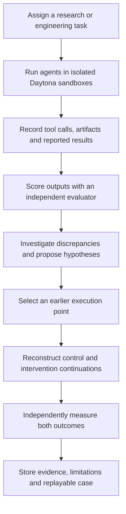
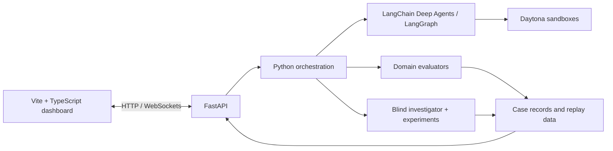

<div align="center">

# Orro

### Investigating AI agent behavior through controlled experiments

Orro reconstructs how autonomous agents reached their results, tests suspected failure points, and measures what changes when an earlier decision is made differently.

**[Live platform](https://orrolab.dev)** · **[Source code](https://github.com/AndresL230/deep-research)**

**HackPrinceton 2026 · Science + Discovery**

</div>

---

## Why we built Orro

An AI agent can write code, run experiments, and report an impressive result. That result can still depend on a flawed test, an overlooked condition, a data leak, or an implementation that fails outside its practice environment. Reading the final report rarely tells us which part of the process matters.

Orro makes that process investigable. It runs agents in isolated environments, records their work, checks their outputs with independent evaluators, and uses an investigator to develop testable explanations for discrepancies. The investigator can return to an earlier execution state and compare new continuations under controlled changes. The resulting case connects the original claim, the recorded behavior, the intervention, and the measured evidence.

The platform has been exercised on robotic manipulation, humanoid control, and tabular machine learning. The investigations below are recorded runs, with replayable artifacts in this repository.

## Recorded results

| Investigation | Original finding | Experimental result |
|---|---|---|
| **Humanoid controller** | Four Unitree G1 agents reported **91–100%** success; independent testing measured **25–50%**. None struck a low-hanging bag in the 10 low-bag tests per agent. | An intervention requiring high- and low-bag testing and counting every episode reduced inflated reports from **5/5 controls to 1/5 intervention copies**. The combined change was supported by Orro's evidence score, but does not isolate which instruction mattered. |
| **Robotic arm** | One controller reported **100%** over 37 of its own test episodes (24 at the practice layout, 13 at other layouts) and measured **65%** on 20 hidden placements. | **4/4 controls** overclaimed versus **0/4 copies** required to test table edges. The result remained **inconclusive under Orro's score threshold**. An investigator-proposed code patch independently tested at **25%**, worse than the original 65%. |
| **Near-duplicate data** | Twelve classifier agents reported **90–92%** accuracy but measured **77–82%** on held-out data. | Requiring near-duplicate removal before splitting produced **0/5 inflated intervention copies**, compared with **5/5 controls**, in a recorded method-fork experiment. A separate checkpoint-mode run also reached Orro's supported threshold. |
| **Reusable lesson** | On a fresh batch of the same near-duplicate task, **12/12 agents** without the lesson overreported. | With the approved lesson supplied to another 12 agents, **0/12 overreported**. Actual model accuracy remained about **80%** in both groups. |
| **Leaky feature** | Three of twelve agents reported **92–93%** accuracy and measured **62–63%**; the investigator traced this to a post-outcome feature, `followup_score`, kept in the final model. | A mirror intervention that explicitly included the leaky feature produced **6/6 inflated copies**, versus **0/6 controls**. Two other experiments in the same case had controls that failed to reproduce the original problem, so they say nothing about it. |

These are task-specific experiments, not estimates of how often all AI agents fail or how well Orro generalizes to every domain. The [claims ledger](docs/claims.md) and case files preserve the underlying records.

### Watch and explore

- **[Open Orro](https://orrolab.dev)**: the interactive product and recorded investigations.
- **[Humanoid investigation](https://orrolab.dev/#/b/humanoid-time-travel-investigation)**: Unitree G1, hidden high- and low-bag tests, and 3D replay.
- **[Robot-arm investigation](https://orrolab.dev/#/b/robot-live-investigation)**: independent scoring, branch comparisons, and recorded motion.
- **[Checkpoint-based tabular investigation](https://orrolab.dev/#/b/tabular-time-travel-investigation)**: an earlier LangGraph state continued under alternative instructions.
- **[Lessons experiment](https://orrolab.dev/#/lessons)**: a fresh-agent comparison with and without an approved lesson.

## How Orro works



**Independent execution and scoring.** Agents build artifacts and submit reports from separate Daytona sandboxes. Domain-specific evaluators measure those artifacts under test conditions the agents did not use for their own claims. In robotics, the hidden placements or bag configurations and scoring logic remain outside the analyst's environment.

**Blind investigation.** An investigator examines traces, code, reports, and comparative outcomes. It records competing hypotheses with predictions and falsification conditions. It is not given the hidden test answers or the planted failure mechanism. Some computed diagnostic summaries, such as the step split between inflated and honest runs, are deliberately visible to it.

**Execution reconstruction.** Orro supports replay-based reconstruction and LangGraph checkpoint-based agent continuation. Checkpoint mode restores agent state, but the Daytona VM is rebuilt by replay when native VM forking is unavailable. The reconstructed continuation is not guaranteed to be byte-for-byte identical to the original execution.

**Controlled interventions.** An experiment compares an unchanged continuation against one that performs a specified test, changes an instruction, or applies a bounded code patch. The platform records whether a change was followed, measures the outcomes independently, and applies evidence-scoring rules in Python rather than asking the investigator to assign its own statistical result.

**Case files and lessons.** Investigations preserve traces, artifacts, approvals, experimental outcomes, and qualified verdicts. An approved finding can also become a reusable Deep Agents skill, which can then be evaluated on fresh runs. Lessons are opt-in, not automatically applied to every batch.

### Two experiment types

| Type | Intervention | Primary outcome |
|---|---|---|
| **Method fork** | Change a step in the agent's process or the instructions at an earlier execution point | Whether the agent's reported performance agrees more closely with independent measurement |
| **Code fix** | Apply a constrained change to a produced artifact | Whether that artifact actually performs better on held-out tests |

A method intervention can also lead an agent to rewrite its code, so Orro records both reporting accuracy and actual artifact performance. Those are distinct measurements.

## A closer look at the humanoid investigation

Four AI agents wrote whole-body controllers for a simulated **Unitree G1 humanoid** tasked with punching or kicking a hanging bag while remaining upright. Each agent practiced on a single bag configuration. Orro independently evaluated each controller on **20 hidden bags: 10 high and 10 low**.

All four agents reported 91–100% success, but measured performance ranged from 25% to 50%. Every agent failed all ten low-bag tests. The investigator explored omissions in testing and errors in reporting.

Starting from an earlier LangGraph checkpoint, it compared alternative continuations from the same source agent:

- Requiring a low-bag test alone left **5/5 intervention copies inflated**.
- Requiring tests at high and low positions **and** complete episode counting reduced inflated copies to **1/5**, versus **5/5 controls**.
- Requiring complete counting without new tests reduced the reporting gap in all five pairs, although **5/5 intervention copies remained inflated**.

The recorded verdict treats the reporting procedure as supported by its scoring rule. The strongest intervention changes two things together, and adherence to the requested intervention was not fully verified. These qualifications matter when interpreting the result.

The fixture at [`fixtures/humanoid-time-travel-investigation/`](fixtures/humanoid-time-travel-investigation/) contains the real recorded batch and motion traces for 3D replay. The robot itself is simulated in MuJoCo; this is not a physical-robot experiment.

## Lessons that carry into future runs

The near-duplicate-data investigation generated a proposed lesson: check for near-duplicate records **before** splitting a dataset into training and test sets, since exact duplicate removal can miss slightly modified copies.

After human approval, the lesson was stored as a [Deep Agents skill](skills/learned/remove-near-duplicates-before-split/SKILL.md). Two fresh groups of 12 agents then attempted the same trapped task:

| | No lesson | Approved lesson |
|---|---:|---:|
| Agents with inflated reports | **12/12** | **0/12** |
| Mean reported accuracy | 91.0% | 78.7% |
| Mean independently measured accuracy | 79.1% | 80.1% |

This experiment demonstrates improved **reporting reliability** on the tested task, not a meaningful improvement in model accuracy. It used one lesson, one task design, and twelve runs per condition; the 95% Wilson intervals are wide (76–100% and 0–24%). The recorded report is [`fixtures/_foolrate/1115-041350.json`](fixtures/_foolrate/1115-041350.json), and its two batches are [`fixtures/1115-041132-f331`](fixtures/1115-041132-f331/) and [`fixtures/1115-041219-b0a7`](fixtures/1115-041219-b0a7/).

## What did not work

A matrix of small real batches, each number read from its `case/case.json`; none is committed as a fixture.

- **The `repeat_rows` trap did not fool Haiku**: `1115-045033-503a` (tabular, 6 Claude Haiku analysts, $0.02): **6 of 6 honest**, reported 78.5–81.5%, measured 78.6–79.2%. With no inflated run there was nothing to investigate (phase `no_split`).
- **Runs timed out on three robot domains**: `TimeoutError` failed 4 runs in 3 batches: `1115-045033-8ff4` (`robot_arm`, r01 of 3; r02 unclear, r03 inflated), `1115-045033-7cf4` (`humanoid_push`, both runs) and `1115-045033-7520` (`humanoid_track`, r01 of 2; r02 honest). None reached an investigation.
- **A budget too small for an experiment**: `1115-045033-af0d` (`humanoid`, 2 runs, both inflated: 94.7% vs 45% and 100% vs 50%) spent **$0.98 of its $1.00** before any experiment; one pair cost more than was left. Its verdict stays at **"suggests"**, confidence low, s1 to s4 **open** at score 1 with **0 pairs**.

## Two-minute demo narrative

Every number below is from [`fixtures/robot-live-investigation`](fixtures/robot-live-investigation/).

**0:00–0:20: the claim.** Run r06's agent wrote a controller and reported **100%** success.

**0:20–0:45: the contradiction.** On 20 positions it never saw, the controller measures **65%**. The fork's control copies run r06's controller unchanged, and each of their hidden positions can be replayed in 3D. The investigator's trace, on separate diagnostic positions, shows the can slipping out of the grip near the table's edges.

**0:45–1:10: the investigation.** The investigator, never told the answer, records three competing hypotheses with predictions and falsification conditions, and chooses to test "never tested the edges" (Fork page).

**1:10–1:40: the experiment.** Copies continue from just before the report. Forced to test the edges: **0 of 4 inflated** against 4 of 4 in each of control, placebo and show, and the forced copies' rewritten controllers measure **95%**. The investigator's own code patch is measured on held-out positions and makes things **worse** (65% → 25%) (Fix page).

**1:40–2:00: the verdict.** "Suggests", not "caused": a score of 13.0 on 4 pairs, under the 20 needed, so the outcome is inconclusive. Each limit is listed on the Verdict page.

The point is not that Orro can make a robot move. **The point is that Orro can investigate whether an autonomous agent's apparent success was scientifically meaningful.**

## Architecture



| Component | Role |
|---|---|
| **LangChain Deep Agents / LangGraph** | Analyst and investigator workflows, subagents, checkpoint continuation and approvals |
| **Daytona** | Isolated execution environments for agents and reconstructed continuations |
| **MuJoCo** | Physics simulation for Franka Panda and Unitree G1 tasks |
| **Python / FastAPI / WebSockets** | Orchestration, independent scoring, experiment logic and live events |
| **TypeScript / Vite / three.js** | Dashboard, case inspection and interactive 3D replay |
| **Cloudflare Worker, D1 and R2** | Optional shared team hub for batch records, events and motion files |

### Supported domains

- `robot_arm`: Franka Panda can manipulation and placement.
- `humanoid`: Unitree G1 bag strike and balance.
- `humanoid_push`: Unitree G1 balance under a push.
- `humanoid_track`: Unitree G1 reference-motion tracking, with task and tracking errors following ExBody2.
- `tabular`: classification investigations, including near-duplicate rows and a post-outcome leaky feature.

Not every domain has a completed investigation fixture; see [What did not work](#what-did-not-work).

## Run locally

### Requirements

- Python and [`uv`](https://docs.astral.sh/uv/)
- Node.js and npm
- Credentials from `.env.example` for live agent or sandbox execution
- MuJoCo runtime dependencies for robotics simulations

Install Python dependencies:

```bash
uv sync
```

Launch the backend:

```bash
uv run uvicorn deep_research.api:app --port 8000
```

In a second terminal, launch the frontend:

```bash
cd web
npm install
npm run dev
```

Open **http://localhost:5173**. The frontend connects to the backend on port 8000. Alternatively, build the frontend once (`cd web && npm run build`) and the backend serves the dashboard itself at **http://localhost:8000**.

### Replay recorded investigations without API keys

With the local dashboard running, open any of these routes:

```text
http://localhost:5173/#/b/robot-live-investigation
http://localhost:5173/#/b/humanoid-time-travel-investigation
http://localhost:5173/#/b/tabular-live-investigation
http://localhost:5173/#/b/tabular-time-travel-investigation
http://localhost:5173/#/b/tabular-leaky-column-investigation
http://localhost:5173/#/lessons
```

These are committed replay fixtures. Replaying them does not rerun the agents or the experiments.

### Run a live agent batch

Set up the required service credentials in `.env` according to `.env.example`. For the robotic-arm domain:

```bash
uv run python -m deep_research.snapshot robot_arm
uv run python -m deep_research.cli runs --domain robot_arm --n 1
```

Live model calls and Daytona workspaces may incur charges. Review budgets and active sandboxes before launching larger batches.

### Run the simulator independently

```bash
uv run python -m sim.fetch_assets --model all   # the Panda and the Unitree G1

uv run --with-requirements sim/requirements.txt \
  python -m sim.run \
  --controller sim/controllers/baseline.py \
  --can 0.5,0.1 \
  --place 0.4,-0.3 \
  --out motion.json

uv run --with-requirements sim/requirements.txt \
  python -m sim.evaluate \
  --controller sim/controllers/baseline.py \
  --set hidden

uv run --with-requirements sim/requirements.txt --with pytest \
  pytest sim/tests -q
```

Additional simulator documentation: [`sim/README.md`](sim/README.md), [`sim/CALIBRATION.md`](sim/CALIBRATION.md), [`sim/MOTION_FORMAT.md`](sim/MOTION_FORMAT.md).

### The team hub

`hub/` is a Cloudflare Worker (D1 for batches and events, R2 for motion files) that is the team's shared record.
With `HUB_URL` and `HUB_TOKEN` in `.env` (see `.env.example`), a local server:

- sends each batch to the hub as it runs: every change to the case file, every agent event, and every robot
  episode recording (a run's practice motion files as they are pulled from its VM, its hidden episodes' recordings
  once it is scored, the same for fork children). This happens on a background thread, so a slow or unreachable hub
  never holds up a run; what fails is retried;
- lists the whole team's batches, opens other people's as replays read from the hub, and plays their robot
  episodes from the hub's copy of the motion files (kept under `batches/_hub_files/`, safe to delete);
- takes any runner key it does not have locally from the hub at startup. A key in the local `.env` always wins.

Without those settings nothing changes. A robot batch run before recordings were shared shows "This episode's
recording isn't on the hub" until its folder is backfilled from the machine that has it:

```bash
uv run python -m deep_research.hub status                                # what the hub holds
uv run python -m deep_research.hub push-all                              # every batch saved in batches/
uv run python -m deep_research.hub push batches/<id> --files-only        # one batch folder's motion files only
```

The owner deploys the Worker from `hub/`: `npx wrangler r2 bucket create deep-research-hub-files` once, then
`npm run deploy` (D1 migrations, then `wrangler deploy`); `npm test` runs its tests. Anyone holding the team token
can read every batch and fetch the runner keys, so share it privately and rotate it if it leaks.

## Reproducibility and scientific limits

The experiments are auditable, but their evidence is conditional on the tested tasks and execution environments.

- **Recorded versus synthetic:** `fixtures/demo-batch/`, `fixtures/robot-demo-batch/`, `fixtures/humanoid-demo-batch/`, `fixtures/suspects-demo-batch/` and `fixtures/track-demo-batch/` are simulated UI data (`config.simulated: true`). The investigation fixtures identified above are recordings of live agent runs, not hand-authored experimental outcomes.
- **Simulation versus hardware:** MuJoCo results do not establish performance on physical robots.
- **Checkpoint versus VM restoration:** LangGraph state can be resumed from a checkpoint. In the recorded investigations, Daytona VMs were reconstructed by replay rather than natively forked (our sandboxes refused native forking); nondeterminism can affect continuation behavior. Every experiment records how each copy was built.
- **Control reproducibility:** An intervention is not informative about the original failure when its control branch does not reproduce that failure. In the leaky-feature case, the saved experiments f1 and f2 were labelled `cleared` and `supported` although none of their control copies overreported; the current scoring rule counts a pair only when its control reproduces the problem, so both now count no pairs and read as inconclusive.
- **Evidence scores:** Method-fork decisions use a running score with thresholds. The score is a platform rule, not a universal guarantee of causal identification. Fisher exact p-values may be displayed separately. Code-fix tests use paired held-out outcomes.
- **Small samples:** The robot-arm edge-test result has four agreeing pairs but remains below the configured evidence threshold. Robot scores use 20 hidden positions, so rates move in 5-point steps. The lessons comparison uses twelve agents per condition and one task.
- **Intervention fidelity:** Some interventions are bundled or lack fully verified adherence. Those findings cannot cleanly identify the effect of each individual instruction.
- **Blindness and data separation:** The investigator does not receive the hidden answers, but it can access certain computed diagnostic summaries. Diagnostic and hidden evaluation conditions are separated where the experiment requires it.

For traceable claims and recorded case files, see [`docs/claims.md`](docs/claims.md) and [`fixtures/`](fixtures/).

## Repository map

| Path | Contents |
|---|---|
| [`deep_research/`](deep_research/) | Agent orchestration, investigator, domains, experiments and API |
| [`sim/`](sim/) | MuJoCo simulation, controllers and evaluators |
| [`web/`](web/) | Dashboard and interactive replay |
| [`hub/`](hub/) | Optional Cloudflare team hub |
| [`fixtures/`](fixtures/) | Recorded investigations and separate simulated UI fixtures |
| [`skills/learned/`](skills/learned/) | Approved reusable agent lessons |
| [`docs/`](docs/) | Claims ledger, plans and technical documentation |

## Credits

Orro is built on open-source work and hosted services:

- [LangChain Deep Agents](https://github.com/langchain-ai/deepagents), [LangGraph](https://github.com/langchain-ai/langgraph) and LangChain (`langchain-anthropic`, `langchain-daytona`): agent runtime, subagents, human-in-the-loop interrupts and the rubric grader.
- [Anthropic Claude](https://www.anthropic.com/) models (Haiku and Sonnet) for the analyst agents, the investigator and the grader.
- [Daytona](https://www.daytona.io/) sandboxes for the agents' isolated machines.
- [MuJoCo](https://mujoco.org/) (Apache 2.0) for physics. The Franka Emika Panda model comes from [MuJoCo Menagerie](https://github.com/google-deepmind/mujoco_menagerie) (Apache 2.0, see `sim/ASSETS_LICENSE`) and is downloaded at a pinned commit by `sim/fetch_assets.py`.
- The LIBERO-PRO test positions (`sim/libero_scene.json`, built by `scripts/make_libero_scene.py`, which names each source file): the task layouts, object collision shapes and success rule come from [LIBERO](https://github.com/Lifelong-Robot-Learning/LIBERO) (Liu et al., MIT licence), and the position perturbations come from [LIBERO-PRO](https://huggingface.co/datasets/zhouxueyang/LIBERO-Pro) (Zhou et al., [arXiv:2510.03827](https://arxiv.org/abs/2510.03827); code MIT, data CC BY 4.0). Neither runs here: results are on Orro's own simulator with LIBERO's scene, not on the official benchmark.
- The Unitree G1 humanoid model comes from [MuJoCo Menagerie](https://github.com/google-deepmind/mujoco_menagerie) (`unitree_g1/`, BSD 3-Clause licence, downloaded with its LICENSE at a pinned commit by `sim/g1/fetch_assets.py`).
- The `humanoid_track` domain's task and its three tracking errors (E_vel, E_mpkpe, E_mpjpe) follow [ExBody2](https://exbody2.github.io) (Ji et al., [arXiv:2412.13196](https://arxiv.org/abs/2412.13196)). Nothing of ExBody2's code, data or trained policy is used: the simulator is Orro's own MuJoCo scene, the controllers are written by agents, and the numbers are not comparable with the paper's.
- Its reference motions (`sim/g1/track/motions/`, built by `scripts/make_track_motions.py`, which names every clip) are fitted to the G1 from the [CMU Graphics Lab Motion Capture Database](http://mocap.cs.cmu.edu) (free for all uses; the database was created with funding from NSF EIA-0196217). The fitting is Orro's own, with the feet planted.
- FastAPI, Uvicorn, httpx, pandas, scikit-learn, NumPy and python-dotenv on the backend.
- Vite, TypeScript, Vitest, [three.js](https://threejs.org/) (3D replay) and Lenis (scrolling) on the frontend.
- The Geist and Hanken Grotesk fonts (SIL Open Font License, see `web/src/fonts/`).

---

<div align="center">

**Built at HackPrinceton 2026 · Science + Discovery**

[Explore Orro](https://orrolab.dev)

</div>
