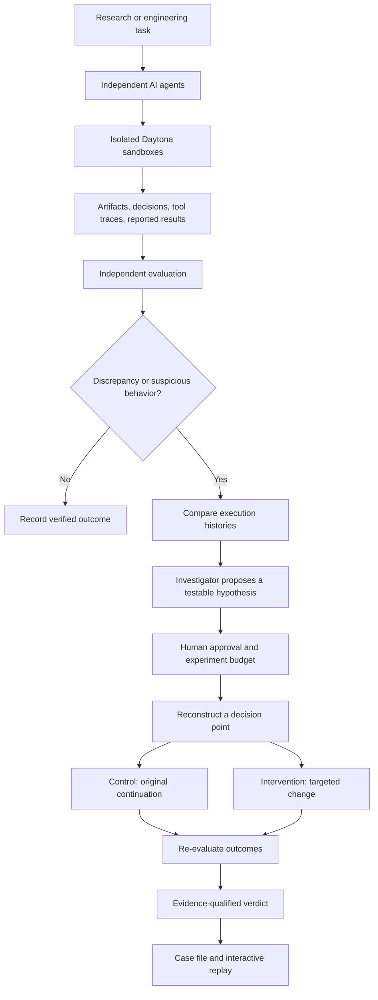
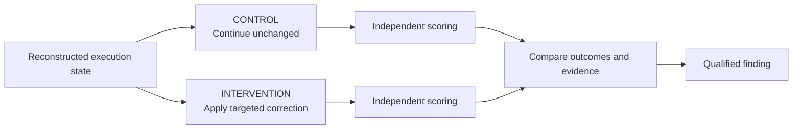
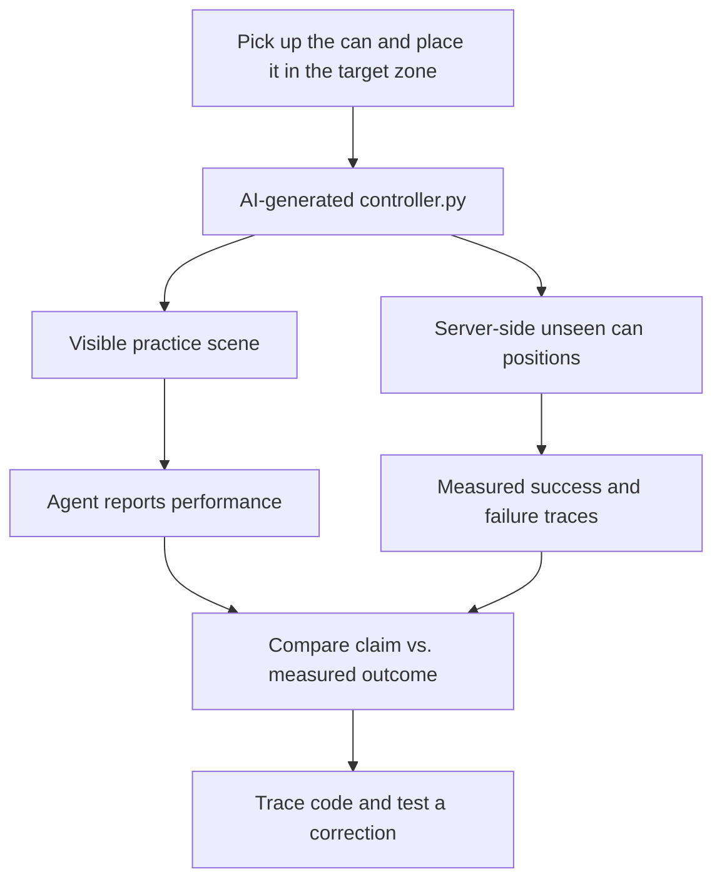
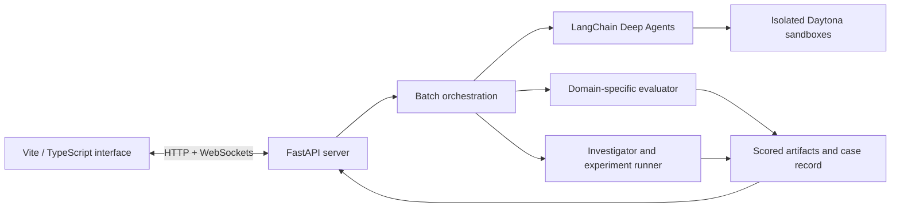

<div align="center">

# Orro

### The scientific debugger for autonomous AI agents

**AI agents can run experiments. Orro investigates whether their conclusions deserve to be trusted.**

*Independent verification · Execution tracing · Controlled interventions · Evidence-based verdicts*

**HackPrinceton 2026 · Science + Discovery**

</div>

---

## The problem

Autonomous AI agents are becoming capable of writing code, conducting experiments, interpreting results, and presenting conclusions with minimal human supervision.

But **a successful run is not necessarily a sound experiment**.

An agent can produce convincing results while relying on an inadequate test, an accidental shortcut, a brittle implementation, or a methodological decision that does not generalize. A polished explanation does not reveal which decision caused the problem—or whether correcting that decision would change the outcome.

Most evaluation systems stop at **“Did the agent succeed?”** Orro asks a harder set of questions:

1. **What did the agent claim?**
2. **What happens under independent evaluation?**
3. **Where did the agent's process go wrong?**
4. **Can we experimentally test the suspected cause?**
5. **How strong is the resulting evidence?**

Orro turns agent evaluation into an **investigation of the process that produced the result**.

## What is Orro?

**Orro is an experimental auditing platform for autonomous AI research agents.**

It launches independent agents in isolated execution environments, records their work, evaluates their outputs against a separate ground-truth procedure, and investigates discrepancies between claims and measured outcomes. When it identifies a suspicious decision, Orro can reconstruct the relevant execution state and compare the original continuation against an intervention.

Instead of merely generating a critique, Orro attempts to **test an explanation**.

The underlying workflow is designed to apply across computational research and agent-driven engineering tasks. **Our flagship demonstration is robotic control**: AI agents write controllers for a simulated robotic arm, and Orro investigates whether apparent success survives unfamiliar conditions.

> **The key distinction:** Orro is not a robotic-arm controller. It is a system for auditing *how autonomous agents reach and justify their results*. Robotics makes that process visible.

## How it works



### 01 / Observe independent agents

Multiple research agents receive the same task, but work in separate Daytona environments. Each agent can write code, execute tools, inspect outputs, and report a result. Orro preserves the artifacts and execution history needed to inspect **what the agent actually did**, not just what it said it did.

### 02 / Verify claims independently

Orro uses a domain-specific evaluator to measure the submitted artifact under conditions separate from the agent's own testing. This creates a meaningful comparison between **self-reported performance** and **independently measured performance**.

The evaluation procedure is implemented outside the analyst's sandbox. For the robotics demonstration, unseen object placements and their scoring logic remain server-side.

### 03 / Investigate the process

When claims and measured results diverge, Orro examines execution traces and artifacts to identify plausible failure points. The investigator can inspect the code and relevant steps, formulate a hypothesis, and request an experiment.

A suspicious step is a **candidate explanation**, not an established cause.

### 04 / Run a controlled intervention

Orro reconstructs an earlier point in the agent's execution and compares continuations with and without a targeted change. The platform's experiment machinery supports an unchanged control and an intervention branch; additional comparison arms may be available depending on the intervention.



This is the heart of Orro: **instead of asking an LLM whether an explanation sounds plausible, test whether changing the suspected decision changes the result**.

### 05 / Produce an auditable case

Orro stores run histories, investigation steps, experiment outcomes, and a qualified verdict in a case record. The web interface can display live execution, compare branches, and replay recorded behavior.

The result is not simply a pass/fail label. It is a traceable account of **what was claimed, what was measured, what was changed, and what the evidence supports**.

---

## Flagship demonstration: a robotic arm that succeeds for the wrong reasons

Our HackPrinceton demonstration uses a **Franka Panda robotic arm in MuJoCo**.

An autonomous AI agent is tasked with writing a Python controller that picks up a can and places it in a target zone. The agent can test its controller in a practice scene and report its performance.

The catch: **success at a familiar object position does not establish generalization**.

A controller may work at the practice location while failing when the can starts somewhere else. It might rely on fixed coordinates, an overly narrow trajectory, inadequate grasp alignment, or a testing procedure that never exercised the relevant variation.

Orro does not assume which explanation is correct. It gathers evidence.

### The experiment

| Stage | What the audience sees | What Orro is testing |
|---|---|---|
| **Agent execution** | Independent agents develop and test robot controllers | What did each agent build and claim? |
| **Hidden evaluation** | The same controllers attempt unseen can placements | Does apparent success generalize? |
| **Failure replay** | Recorded robot motions reveal missed, dropped, or tipped objects | What actually happened? |
| **Investigation** | Execution history and controller code are inspected | Which decision might explain the failure? |
| **Intervention** | An unchanged continuation is compared with a targeted correction | Does changing that decision improve the measured outcome? |
| **Verdict** | Scores, traces, and evidence are shown together | What conclusion is justified by the experiment? |

### What gets measured?

The robotics evaluator records episode outcomes such as `placed`, `dropped`, `tipped`, and `missed`, along with placement error, test conditions, and motion traces. This makes a failure **observable**, **replayable**, and **independently scored**.



**Why robotics?** It makes methodological failure tangible. Rather than showing only a number, we can show the arm reaching to the wrong location, missing a grasp, or failing to place an object—and then examine the code and decisions behind that behavior.

**Why not robotics only?** The agent orchestration, observation, independent evaluation, experiment branching, and evidence reporting are the platform. The robotic simulator is one domain-specific evaluator connected to that workflow.

---

## What makes Orro different?

| Conventional agent evaluation | Orro's approach |
|---|---|
| Checks a final answer or benchmark score | Inspects the **execution process** behind the answer |
| Trusts an agent's own tests or summary | Runs **independent evaluation** |
| Uses another model to speculate about mistakes | Attempts **controlled interventions** to test explanations |
| Reports success or failure | Connects **claims, traces, interventions, and outcomes** |
| Produces a one-off judgment | Preserves an **auditable case record and replay** |

Orro is designed to bridge the gap between **agent observability** and **experimental evidence**.

## System architecture



### Technology

- **LangChain Deep Agents / LangGraph** — autonomous agent execution and structured investigation workflows.
- **Daytona** — isolated environments for independent agent work and experiment reconstruction.
- **Python** — orchestration, scoring, experiment logic, and simulation integration.
- **MuJoCo** — physics simulation for the robotic-arm demonstration.
- **FastAPI + WebSockets** — batch control, state, and live updates.
- **Vite + TypeScript** — investigation dashboard, run comparisons, and replay UI.

### Repository guide

| Path | Purpose |
|---|---|
| `deep_research/agents/analyst.py` | Autonomous analyst execution |
| `deep_research/agents/investigator.py` | Investigation and experiment requests |
| `deep_research/batch.py` | Batch execution and experiment orchestration |
| `deep_research/sandboxes.py` | Daytona sandbox lifecycle and reconstruction |
| `deep_research/domains/robot_arm.py` | Robotics task and evaluation integration |
| `deep_research/api.py` | Backend API and event streaming |
| `sim/` | Franka Panda simulation, controllers, and scoring |
| `web/` | Interactive frontend |
| `fixtures/robot-demo-batch/` | **Simulated** robotics replay data for UI testing |
| `docs/` | Design notes, development plans, and progress |

---

## Getting started

### Requirements

- Python and [`uv`](https://docs.astral.sh/uv/)
- Node.js and npm for the web interface
- Credentials for the agent and sandbox services when running live experiments (see `.env.example`)
- MuJoCo dependencies for the robotics demonstration

### Install Python dependencies

```bash
uv sync
```

### Prepare the robotics simulator

```bash
uv run python -m sim.fetch_assets
```

Run a practice episode and save a motion trace:

```bash
uv run --with-requirements sim/requirements.txt \
  python -m sim.run \
  --controller sim/controllers/baseline.py \
  --can 0.5,0.1 \
  --place 0.4,-0.3 \
  --out motion.json
```

Run the independent position evaluator locally:

```bash
uv run --with-requirements sim/requirements.txt \
  python -m sim.evaluate \
  --controller sim/controllers/baseline.py \
  --set hidden
```

Run simulation tests:

```bash
uv run --with-requirements sim/requirements.txt --with pytest \
  pytest sim/tests -q
```

### Run a live robotics agent batch

Configure the service credentials documented in `.env.example`, then prepare the robotics sandbox image and launch a batch:

```bash
uv run python -m deep_research.snapshot robot_arm
uv run python -m deep_research.cli runs --domain robot_arm --n 1
```

Live model calls and Daytona workspaces may incur charges. Review experiment budgets and active sandboxes before running larger batches.

### Launch the dashboard

Backend:

```bash
uv run uvicorn deep_research.api:app --port 8000
```

Frontend, in another terminal:

```bash
cd web
npm install
npm run dev
```

The development frontend runs at `http://localhost:5173` and connects to the backend on port `8000`.

### The team hub

`hub/` is a Cloudflare Worker (D1 for batches and events, R2 for motion files) that is the team's shared record.
With `HUB_URL` and `HUB_TOKEN` in `.env` (see `.env.example`), a local server:

- sends each batch to the hub as it runs: every change to the case file, every agent event, and every robot
  episode recording (a run's practice motion files as they are pulled from its VM, its hidden episodes' recordings
  once it is scored, the same for fork children). This happens on a background thread, so a slow or unreachable hub
  never holds up a run; what fails is retried;
- lists the whole team's batches, opens other people's as replays read from the hub, and plays their robot
  episodes from the hub's copy of the motion files (kept under `batches/_hub_files/`, safe to delete);
- takes any runner key it does not have locally from the hub at startup. A key in the local `.env` always wins.

Without those settings nothing changes. A robot batch run before recordings were shared shows "This episode's
recording isn't on the hub" until its folder is backfilled from the machine that has it:

```bash
uv run python -m deep_research.hub status                                # what the hub holds
uv run python -m deep_research.hub push-all                              # every batch saved in batches/
uv run python -m deep_research.hub push batches/<id> --files-only        # one batch folder's motion files only
```

The owner deploys the Worker from `hub/`: `npx wrangler r2 bucket create deep-research-hub-files` once, then
`npm run deploy` (D1 migrations, then `wrangler deploy`); `npm test` runs its tests. Anyone holding the team token
can read every batch and fetch the runner keys, so share it privately and rotate it if it leaks.

For simulator internals, see [`sim/README.md`](sim/README.md), [`sim/CALIBRATION.md`](sim/CALIBRATION.md), and [`sim/MOTION_FORMAT.md`](sim/MOTION_FORMAT.md).

---

## Two-minute demo narrative

**0:00–0:20 — The claim.** An autonomous agent builds a robotic-arm controller and demonstrates success in its practice environment.

**0:20–0:45 — The contradiction.** Orro evaluates the same controller at unseen positions. A replay reveals a failure the practice run did not expose.

**0:45–1:10 — The investigation.** Orro inspects the controller and execution history, then identifies a specific, testable explanation.

**1:10–1:40 — The experiment.** Compare the original continuation with an intervention, scored under the same evaluation procedure.

**1:40–2:00 — The evidence.** Show the measured outcomes, motion traces, and appropriately qualified conclusion.

The point is not that Orro can make a robot move. **The point is that Orro can investigate whether an autonomous agent's apparent success was scientifically meaningful.**

## Scientific integrity and current limitations

Orro is an experimental system, and the distinction between implemented infrastructure and validated scientific findings matters.

- **Hidden evaluation is independent of agent self-reporting.** The robotics evaluator keeps unseen test conditions on the server side.
- **A hypothesis is not a proven cause.** An observed failure or suspicious code path motivates an intervention; it does not establish causality by itself.
- **Execution reconstruction is not perfect time travel.** Replayed or forked agent continuations can differ because of nondeterminism and environment state.
- **Evidence must be qualified.** The repository includes evidence-gating logic, but a single experiment is not universal proof of causality or generalization.
- **Simulation is not physical deployment.** Success in MuJoCo does not establish performance on a real robot.
- **Simulated fixtures are not live experiments.** The repository's prerecorded robotics demo fixture is intended for interface and storytelling tests and must be identified as simulated.
- **Do not overclaim end-to-end validation.** The repository documents real robotics agent batches and experiment infrastructure, but a completed live robotics investigator verdict is not established by the inspected materials.

## The bigger picture

As AI systems take on more scientific and engineering work, verifying the final output will not be enough. We will need tools that can reconstruct the process, identify questionable decisions, and experimentally test whether those decisions explain observed results.

**Orro is a step toward that future: an experimental debugger for the scientific reasoning and engineering work of autonomous AI agents.**

---

<div align="center">

**Orro · Built at HackPrinceton 2026**

*Don't just trust the result. Investigate how it happened.*

</div>
